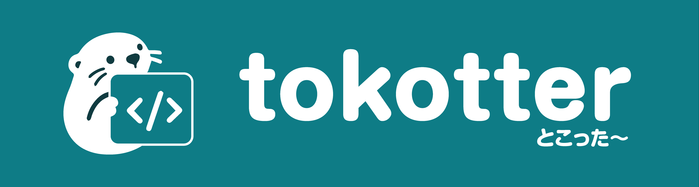

<p align="center">
  
</p>

<p align="center">
  <strong>Inspect web design, extract design tokens, and analyze page structures for rapid prototyping and AI-driven mockups.</strong><br>
  <em>100% local, privacy-first Chrome extension (MV3) with zero tracking and no remote servers.</em>
</p>

<p align="center">
  <a href="#english">English</a> • <a href="#japanese">日本語</a>
</p>

<p align="center">
  
  
  
  
  <a href="https://nozomicreative.com" target="_blank"></a>
</p>

---

<a id="english"></a>
## English

### What is tokotter?

**tokotter** (Token + Otter) is a developer-focused Chrome extension engineered to help designers, frontend engineers, and creators explore web design architectures, extract production-ready design tokens, and archive static page references.

Whenever you encounter a website with exceptional aesthetics, layout balance, or color harmony, tokotter lets you capture its design essence with a single click. Combined with modern AI coding assistants (such as Claude, ChatGPT, Cursor, Gemini, and v0), tokotter transforms live design references into actionable, production-grade assets for your own projects.

---

### Key Use Cases: Turn Web Inspiration into Production

Rather than superficial copying, modern web development thrives on analyzing exemplary design systems and reinterpreting them through AI. tokotter is purpose-built for two primary workflows:

#### 1. Rapid Prototyping & Mockup Creation
- **Extract Design Architecture**: Inspect any inspiring landing page or web application to capture its core design foundation — including color palettes, typography hierarchies, spacing scales, border radii, and elevation shadows.
- **AI-Powered Rebuild**: Feed the extracted `DESIGN.md` and `tokens.json` to an AI tool with prompts like:
  > *"Using the attached design token system and color rules, create a responsive SaaS pricing table component in React and Tailwind CSS."*
- **Instant Wireframes**: Generate cohesive mockups and client-ready prototypes in minutes instead of hours.

#### 2. Enhancing & Applying Design Systems to Your Own Website
- **Reference Extraction**: Identify how high-performing websites achieve visual hierarchy and contrast. Extract computed design tokens formatted for Tailwind CSS v4 (`@theme`), SCSS variables, or modern CSS Custom Properties (`:root`).
- **Seamless Adaptation**: Instruct your AI coding assistant:
  > *"Refactor my existing landing page hero section to adopt this extracted color palette and typography scale, maintaining my brand identity while elevating readability."*
- **Accessibility Verification**: Built-in WCAG contrast ratio checks ensure every extracted color combination meets accessibility standards (AA pass/fail) before deployment.

---

### Core Features

tokotter runs entirely in a dedicated Chrome Side Panel across five specialized tabs:

1. **Inspect**:
   - Interactive hover-and-pin inspector directly on the active webpage.
   - Highlights layout boxes, element dimensions, typography rules, and computed CSS.
   - One-click copy for clean, filtered CSS rules.

2. **Tokens (9-File Comprehensive Token Pack)**:
   - Scans the DOM and CSSOM to build a complete design system.
   - Generates a structured ZIP archive containing:
     - `DESIGN.md`: Human-readable design system overview.
     - `tokens/tokens.json`: Structured token manifest (Schema 1.1).
     - `tokens/theme.css`: Clean CSS Custom Properties.
     - `tokens/tailwind-v4.css`: Ready-to-use `@theme` rules for Tailwind CSS v4.
     - `tokens/_tokens.scss`: SCSS variables for traditional build pipelines.
     - `tokens/tokens.ts`: Strictly typed TypeScript constants.
     - `tokens/HOW-TO-USE.md`: Integration guide for development teams.
     - `extras/accessibility.md`: Foreground/background WCAG 2.1 AA contrast matrix.
     - `extras/REBUILD.md`: Structured AI prompting brief for component reconstruction.

3. **Clone (7-File Static Reference Archive)**:
   - Captures a self-contained static DOM snapshot and styles without server roundtrips.
   - Includes a responsive `viewer.html` (390px / 834px / 1280px / 1600px width switcher).
   - Generates `tokotter-states.json` recording interactive component mutations.
   - Outputs `asset-manifest.json` cataloging external media and font sources.

4. **Library**:
   - Local IndexedDB history of all generated token packs and page references.
   - Re-download or remove past captures without leaving the browser.

5. **Settings & Localization**:
   - Instant language switching between English and Japanese.
   - Local storage footprint monitor and single-click cache wipe.

---

### Privacy by Design: 100% Local & Zero Telemetry

- **No Remote Servers**: Zero API calls to external hosts. No cloud database.
- **No User Accounts**: No login, sign-up, email collection, or OAuth required.
- **Zero Telemetry**: No Google Analytics, no error reporting beacons, no user behavior tracking.
- **Local File Generation**: All ZIP packaging and token derivations are processed in-memory via Web Workers and saved locally through the native `chrome.downloads` API.

---

### Installation Guide (Developer Mode)

Because tokotter is a privacy-first open-source developer utility distributed outside the Chrome Web Store, install it using Chrome's **Developer Mode**:

#### Step 1: Clone or Download the Repository
Clone via Git:
```bash
git clone https://github.com/nozomicreative/tokotter.git
cd tokotter
```
*(Or click **Code > Download ZIP** on GitHub and extract the archive to a local folder).*

#### Step 2: Install Dependencies & Build
Ensure you have [Node.js](https://nodejs.org/) (v20 or newer) installed:
```bash
npm install
npm run build
```
This compiles the extension into the `.output/chrome-mv3` directory.

#### Step 3: Load into Google Chrome
1. Open Google Chrome and navigate to:
   ```text
   chrome://extensions
   ```
2. In the top-right corner, toggle the **Developer mode** switch to **ON**.
3. In the top-left corner, click the **Load unpacked** button.
4. Select the `.output/chrome-mv3` directory inside your `tokotter` project folder.
5. tokotter is now installed! Pin the extension icon to your Chrome toolbar for quick access.

---

### How to Use

1. Navigate to any public webpage you wish to study.
2. Click the **tokotter** icon in your toolbar to slide out the side panel.
3. Click **Scan** to analyze the DOM and CSS architecture.
4. Use **Inspect** to examine individual elements, **Tokens** to export design tokens, or **Clone** to capture the page structure.
5. Attach the generated tokens or prompts to your favorite AI assistant to build your next mockup or website feature!

---

### Technology Stack & Architecture

- **Framework**: [WXT](https://wxt.dev/) (Next-generation Web Extension Framework)
- **Language**: TypeScript 5.6
- **Bundler**: Vite 5.4
- **Testing**: Vitest (100% unit test coverage for color contrast and token generation)
- **Compression**: [fflate](https://github.com/101arrowz/fflate) (High-performance in-memory ZIP archiver)

---

### About the Creator

tokotter is designed and maintained as an open-source initiative by **[Nozomi Creative](https://nozomicreative.com)**.

Nozomi Creative is a creative engineering studio specializing in bespoke web production, high-conversion landing pages, brand identity systems, and AI-integrated digital workflows. If you are looking to build modern, high-performance websites or need custom design solutions, explore our work:

🌐 **Website**: [https://nozomicreative.com](https://nozomicreative.com)

---

### License

This project is open-source software licensed under the [MIT License](LICENSE).  
Copyright (c) 2026 [Nozomi Creative](https://nozomicreative.com).

---
---

<a id="japanese"></a>
## 日本語

### tokotter（トコッター）とは？

**tokotter**（Token + Otter / トークン＋カワウソ）は、Webデザイナー、フロントエンドエンジニア、個人開発者のための**完全ローカル完結型 Chrome拡張機能（MV3）**です。

ネット上で「このWebサイトの配色や雰囲気が素晴らしい」「このUIレイアウトを参考にしたい」と感じたとき、tokotterを使えばブラウザ上でワンクリックでデザインシステムを構造解析し、再利用可能なデザイントークンや静的リファレンスを抽出できます。

抽出したデータを Claude、ChatGPT、Cursor、Gemini、v0 などの最新AIツールに連携することで、**モックアップの素早いプロトタイピング**や**自身のWebサイトへのスマートなデザイン適用**を直感的に実現します。

---

### 各機能の使い道：優れたWebデザインをAIで賢く活用する

tokotterは、単にWebサイトを表面上コピーするツールではありません。洗練されたデザインシステムの「エッセンス（配色・余白・タイポグラフィ・構造）」を抽出し、AIへの指示と組み合わせることで独自のクリエイティブへと昇華させるためのリサーチツールです。

主な活用シーンは以下の2点です：

#### 1. モックアップ・プロトタイプの高速作成（Rapid Prototyping）
- **デザインエッセンスの抽出**: 参考になるWebサイトやLP（ランディングページ）を開き、tokotterでスキャン。カラーパレット、フォント階層、余白ルール、ボーダー半径、シャドウをワンクリックで抽出します。
- **AIによるプロトタイプ生成**: 生成された `DESIGN.md` や `tokens.json` をAIに渡し、以下のように指示します：
  > *「添付したDESIGN.mdのデザインルールとカラーパレットをベースに、自社の新規SaaSサービスの料金プラン表コンポーネント（React + Tailwind CSS）のモックアップを作成してください。」*
- **制作スピードの飛躍的向上**: ゼロからデザインルールを策定する手間を省き、完成度の高いプロトタイプやワイヤーフレームを瞬時に構築できます。

#### 2. 自身のWebサイトへの適用・デザイン改善（Site Enhancement）
- **トークン体系の取得**: 憧れのWebサイトがどのように視認性や美しいコントラストを実現しているかを数値化。Tailwind CSS v4（`@theme`）、SCSS変数、CSSカスタムプロパティ（`:root`）として出力します。
- **AIを活用したスムーズな適用**: お使いのAIコーディングツール（CursorやClaudeなど）に以下のようにプロンプトを送信します：
  > *「抽出したTailwindトークンを参考に、既存サイトのボタン、見出し、背景色のCSSをリファクタリングして、統一感のあるモダンなデザインにブラッシュアップしてください。」*
- **アクセシビリティ担保**: 自動算出されるWCAGコントラスト比レポート（`accessibility.md`）により、コントラスト基準（AA合否）を満たした視認性の高いサイト構築が可能です。

---

### 主な機能

tokotterは、Chromeのサイドパネル内で動作し、5つのタブを提供します：

1. **Inspect（要素調査・CSS抽出）**:
   - 閲覧中のWebページ上の要素にマウスを合わせるだけで、マージン・パディング・フォント情報・算出CSSを直感的にハイライト。
   - ピン留めした要素のクリーンなCSSコードをワンクリックでコピー可能。

2. **Tokens（9種類のデザイントークン一括出力）**:
   - ページ全体からデザイントークンを自動抽出し、以下の9ファイルをZIP形式でダウンロード：
     - `DESIGN.md`: デザインシステムの概要ドキュメント
     - `tokens/tokens.json`: Schema 1.1準拠の構造化トークンデータ
     - `tokens/theme.css`: CSSカスタムプロパティ（変数）定義
     - `tokens/tailwind-v4.css`: Tailwind CSS v4対応の `@theme` 設定
     - `tokens/_tokens.scss`: SCSS用変数定義
     - `tokens/tokens.ts`: TypeScript用の型付き定数
     - `tokens/HOW-TO-USE.md`: 各フレームワークでの導入解説
     - `extras/accessibility.md`: 前景色/背景色のWCAGコントラスト比一覧（AA判定）
     - `extras/REBUILD.md`: AIへの指示プロンプト例文入り再構築用ブリーフ

3. **Clone（7種類の静的リファレンス保存）**:
   - 外部サーバを介さず、ブラウザ内でDOMとスタイルを収集した静的アーカイブを保存。
   - レスポンシブ幅切り替え機能付きの `viewer.html`（390px / 834px / 1280px / 1600px）を同梱。
   - インタラクション変化を記録した `tokotter-states.json` や外部アセット一覧 `asset-manifest.json` を出力。

4. **Library（ローカル履歴管理）**:
   - 過去にスキャン・生成したトークンパックの履歴をブラウザ内IndexedDBに保存。いつでも再ダウンロードや削除が可能です。

5. **Settings（設定・言語切替）**:
   - 英語 / 日本語のワンクリック切り替え（再起動後も設定を保持）。
   - ローカルストレージ使用量の可視化と一括クリア機能。

---

### プライバシー最優先設計：100% ローカル完結

- **外部サーバへの送信ゼロ**: 外部API通信やバックエンドサーバは一切存在しません。
- **アカウント・ログイン不要**: ユーザー登録、メールアドレス収集、認証は一切不要です。
- **テレメトリ・行動追跡なし**: Google Analytics等のアクセス解析や追跡コードは含まれていません。
- **ブラウザ内処理**: スキャン、トークン解析、ZIP圧縮（fflate）の全工程がお使いの端末のメモリ上で完結し、Chrome標準のダウンロード機能で保存されます。

---

### インストール方法（デベロッパーモードでの導入）

本拡張機能は、Chromeウェブストアを介さず、オープンソースとしてGitHub上で公開されています。以下の手順に従って、Chromeの**デベロッパーモード**からインストールしてください。

#### ステップ 1: リポジトリのクローン（またはダウンロード）
Gitコマンドでローカルにクローンします：
```bash
git clone https://github.com/nozomicreative/tokotter.git
cd tokotter
```
*(Gitをお使いでない場合は、GitHubページの「Code」緑色ボタンから「Download ZIP」をクリックし、任意のフォルダに解凍してください)*

#### ステップ 2: 依存パッケージのインストールとビルド
PCに [Node.js](https://nodejs.org/)（v20以上推奨）がインストールされていることを確認し、ターミナルで実行します：
```bash
npm install
npm run build
```
ビルドが成功すると、プロジェクト内に `.output/chrome-mv3` というフォルダが生成されます。

#### ステップ 3: Google Chrome への読み込み
1. Google Chrome を開き、アドレスバーに以下を入力してEnterを押します：
   ```text
   chrome://extensions
   ```
2. 画面右上にある **「デベロッパー モード」** のトグルスイッチを **ON** にします。
3. 画面左上に表示される **「パッケージ化されていない拡張機能を読み込む」** ボタンをクリックします。
4. ファイル選択ダイアログで、先ほどビルドで生成された **`.output/chrome-mv3`** フォルダを選択します。
5. これで tokotter のインストールは完了です！ツールバーのパズルアイコンから tokotter をピン留めしておくと便利です。

---

### 使い方

1. 参考にしたいWebサイトやLPをChromeで開きます。
2. ツールバーの **tokotter** アイコンをクリックしてサイドパネルを開きます。
3. **「Scan」** ボタンをクリックしてページのデザイン構造を解析します。
4. **Inspect** で気になるパーツのスタイルを調査、**Tokens** でトークンパックをZIPダウンロード、または **Clone** で静的リファレンスを保存します。
5. ダウンロードしたトークンやブリーフを AI（Claude、ChatGPT、Cursor 等）に読み込ませ、モックアップ作成や自社サイトのブラッシュアップに役立てましょう！

---

### 企画・開発について

tokotter は、Web制作・UI/UXデザイン・デジタルクリエイティブを手がける **[Nozomi Creative (のぞみクリエイティブ)](https://nozomicreative.com)** によって企画・開発されたオープンソースプロジェクトです。

洗練されたWebサイト制作、高成約率のLPデザイン、ブランディング、AIを活用したデジタル開発をご検討の方は、ぜひ公式サイトをご覧ください。

🌐 **Webサイト**: [https://nozomicreative.com](https://nozomicreative.com)  
✉️ **お問い合わせ**: [https://nozomicreative.com#contact](https://nozomicreative.com)

---

### ライセンス

本プロジェクトは [MIT License](LICENSE) の下でオープンソースとして公開されています。  
Copyright (c) 2026 [Nozomi Creative](https://nozomicreative.com).
